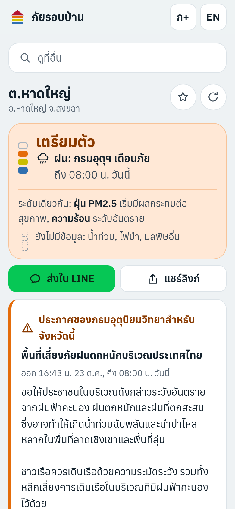
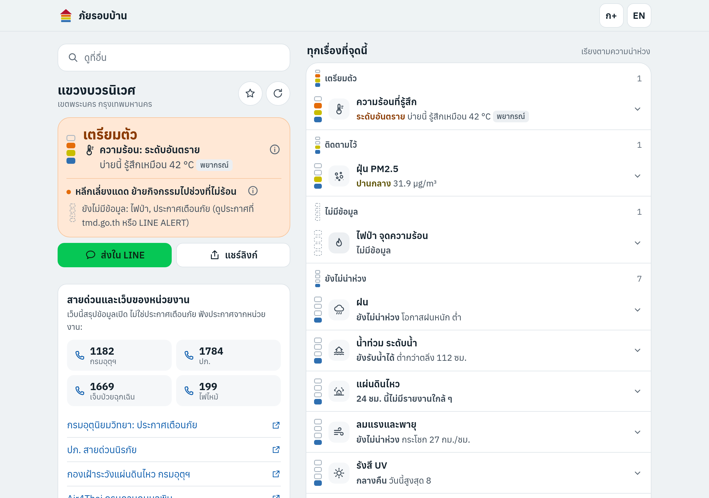

# ภัยรอบบ้าน · Thai Risk

**One page that shows every hazard at a point in Thailand, now and for the next 3 days** (code name `disaster-now`). Tap 📍 (or search a subdistrict, a road, a place) and see, for that point: rain, river level and flash floods, PM2.5 dust and other pollution, heat, UV, wind and storms, landslides, earthquakes and fires, each in the agency's own words with its source and time, one sourced action, and a link to what to do.

> v0.7.0 · 25 Oct 2026 · **live at https://risk.autobahn.bot**, its collector uploading every 15 min; redesigned: one answer first, every hazard sorted by concern, details on demand, the site's own icons, font and level gauge; FloodWatch's gauges and look ahead; the measured 3-day rain; heat in the DOH's colours; simulated in LINE and on tablets, **not yet tried on real phones** ([HANDOFF.md](HANDOFF.md))

  



## What it does

- **Choose a point:** GPS on a tap; instant search over all 7,425 subdistricts, 928 districts and 77 provinces on the phone; Enter asks OpenStreetMap for roads, sois and places (FloodWatch's way of searching: abbreviations and soi variants). Up to five saved places open first next time ("บ้าน", "บ้านแม่").
- **One answer first:** the level by what to do (ยังไม่น่าห่วง, ติดตามไว้, เตรียมตัว, ทำทันที) on a staff gauge (a water-level pole filled from the bottom), never milder than any hazard, naming the worst one in the agency's word with one action from บ้านรอดไหม, the worst coming day, and what is missing.
- **Every hazard in one list, sorted by concern** (needs attention, no data, calm); a row opens in place for the lines, the 3-day strip, the method note, the sources and the links. The 3-day table and the place's long-term profile are folded; a source is one ⓘ away.
- **One forecast, one level, everywhere:** the tile, the card's days, the 3-day table and the pre-warnings grade a forecast the same way, and a forecast alone never goes past เตรียมตัว in any of them. Heat is said as "รู้สึกเหมือน 43 °C" (the heat index), for the afternoon it names, **in the Department of Health's own colours** (เตือนภัย yellow, อันตราย orange).
- **Chances, never countdowns** ("พรุ่งนี้ ฝนหนัก โอกาสสูง"); every number with its source, time and age.
- **Measurements first:** PCD stations, river and canal gauges **as FloodWatch reads them** (its own rows through this site's collector, BMA's canals included; ThaiWater from the phone, judged by FloodWatch's rules, when FloodWatch is down), rain measured over 1–3 days (Hat Yai's red flag, 300 mm in 3 days, named when crossed), HII's flash-flood list, TMD's warnings, which lift their tile and lead.
- **Water from upstream:** FloodWatch's "⚠️ จับตา" lines with how often they came true, and upstream lines on its learned travel times ("within about 12 h, or sooner"), never a countdown.
- **What's coming and what changed:** "ข้างหน้า" names the worst coming day in the verdict; "เปลี่ยนจากที่ดูครั้งก่อน" says what moved since your last look (kept on the phone); the share text carries its own time.
- **Models labelled and validated** ([docs/MODELS.md](docs/MODELS.md)):
  - The ECMWF ensemble (51 runs) for heat. Raw it read 5 °C low; corrected it is within 2.4 °C on held-out stations.
  - Rain as three chance words, gusts labelled unvalidated.
  - CAMS for dust, damped and applied to the measurement, which beat persistence.
  - An intensity equation for "was it felt here?", with a Bangkok term.
  - A forecast alone never says "act now".
- **Private by design:** the exact fix never leaves the phone (providers get ~1 km); shared links and the address bar carry a subdistrict code, not a home; no server, analytics or accounts, and no cookies of its own (Cloudflare's zone currently adds a security cookie: owner action A14).
- **Official warnings lead:** a TMD warning takes its tile, the verdict and the 3-day table, even where the model is milder (it said "low" in all 11 provinces TMD warned on 24 Oct).
- **Thai and English,** larger text, dark mode, installable, a proper preview card in LINE. On the English page, TMD's Thai-only warnings come with GLM's checked machine translation, labelled, with the Thai original one tap away ([docs/AI.md](docs/AI.md)). AI writes nothing else.

## Run it

```
npm install                       # only playwright-core, for the visitor walk
npm run serve                     # http://127.0.0.1:8787/
npm test                          # unit tests on saved live responses
CHROME_PATH=<chromium> npm run smoke            # the visitor walk (fixtures, clock pinned; also an 18:30 page)
CHROME_PATH=<chromium> npm run smoke -- --live  # the same on today's sources, once per change
# <chromium>: /root/.cache/ms-playwright/chromium-1217/chrome-linux64/chrome on autobahn-bot, /opt/pw-browsers/chromium in a cloud session
npm run collect                   # the collector once → public/data/live/
npm run check:advice              # advice lines still equal บ้านรอดไหม's
```

**On the server and on Cloudflare** (the runbook: [docs/SERVER.md §2](docs/SERVER.md#2-the-risk-server-install-go-live-and-leave-floodwatchs-server); [docs/CLOUDFLARE.md](docs/CLOUDFLARE.md)). The collector runs on `autobahn-bot` beside BrainPlatform, by the owner's choice (D-045); never on FloodWatch's server:

```
cp .env.example .env && chmod 600 .env   # fresh on every server, with tokens made for this project
npm run preflight                 # is this host ready? (fails on FloodWatch's server; prints no values)
node tools/env-check.mjs --probe  # which variables are set (never their values) and whether the keys work
docker compose up -d --build      # the page on http://127.0.0.1:8090/ + the collector every 15 min
node tools/health.mjs --web http://127.0.0.1:8090/
npm run cf:setup                  # once: the Workers KV namespace for the collector's files
npm run cf:deploy                 # the page to Cloudflare's edge at risk.autobahn.bot (-- --dry-run first)
```

The page is static (`public/`) and runs on any static host too ([docs/DEPLOY.md](docs/DEPLOY.md)). The collector
(`tools/collect.mjs`, Node ≥ 20, no packages) adds TMD's warnings (with English when `AI_ENABLED=1`), quakes and storm
tracks, NASA FIRMS hotspots and Air4Thai, and uploads them to Workers KV when a KV token is set.

## Sources

ECMWF ensemble and CAMS via Open-Meteo (CC BY 4.0) · Pollution Control Department (Air4Thai) · GISTDA · ThaiWater / HII · Thai Meteorological Department · EMSC (CC BY 4.0) · USGS · JMA RSMC Tokyo · GDACS · Department of Mineral Resources · NASA FIRMS · HDX COD-AB (Royal Thai Survey Department, OCHA; CC BY-IGO) · OpenStreetMap contributors (Photon, Nominatim). Each is tested and described in [docs/SOURCES.md](docs/SOURCES.md).

## The family

It is the third app beside **FloodWatch** (https://flood.autobahn.bot, water) and **บ้านรอดไหม** (https://baanrodmai.autobahn.bot, what to do); its own address is **https://risk.autobahn.bot** (live since 24 Oct 2026). It reads FloodWatch's gauges through its collector and backs FloodWatch up when FloodWatch's server is down (ThaiWater from the phone, FloodWatch's rules); its own ThaiWater statuses agree with FloodWatch's on 737 of 742 gauges; its advice lines are บ้านรอดไหม's word for word. [docs/INTEGRATION.md](docs/INTEGRATION.md).

## Docs

[docs/README.md](docs/README.md) is the index: guidelines, knowledge, known issues, sources, models, methods, integration, Cloudflare, AI (GLM), server, deploy, owner actions, roadmap, and [frank feedback](docs/FRANK_FEEDBACK.md). AI assistants: [AGENTS.md](AGENTS.md).

## Licence

The code and docs are under the [MIT License](LICENSE). The bundled font Anuphan is under the SIL Open Font License
([public/fonts/OFL-Anuphan.txt](public/fonts/OFL-Anuphan.txt)). The data stays under each source's own terms (see
[Sources](#sources) and [docs/SOURCES.md](docs/SOURCES.md)); the MIT licence does not cover it.

This page summarises open data; it is **not a warning service**. Follow the Thai Meteorological Department (1182), DDPM (1784), Cell Broadcast and LINE ALERT.
