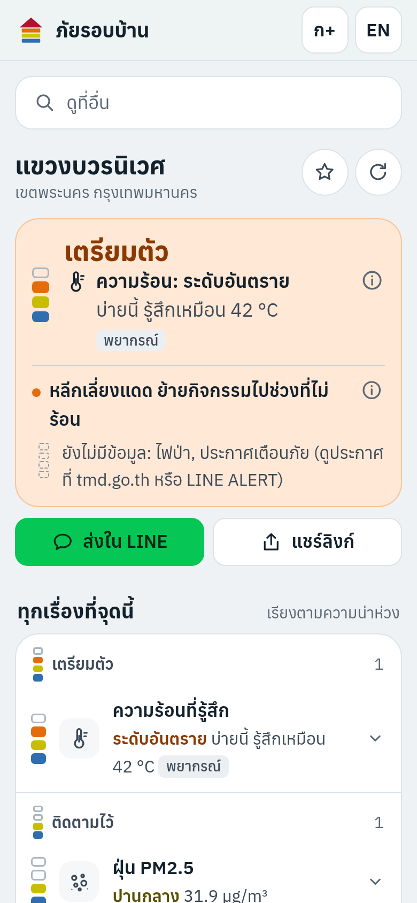
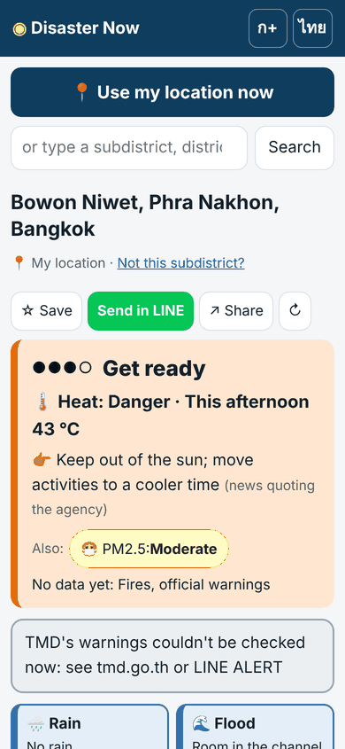
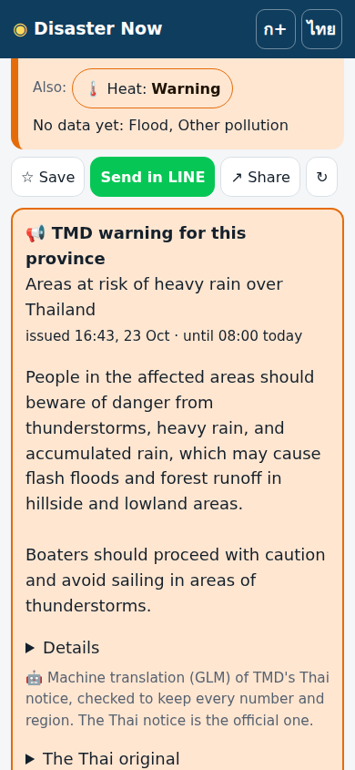

# ภัยรอบบ้าน ตอนนี้ · Disaster Now

**One page that shows every hazard at a point in Thailand, now and for the next 3 days.** Tap 📍 (or search a subdistrict, a road, a place) and see, for that point: rain, river level and flash floods, PM2.5 dust and other pollution, heat, UV, wind and storms, landslides, earthquakes and fires, each in the agency's own words with its source and time, one sourced action, and a link to what to do.

> v0.3.0 · 24 Oct 2026 · **built, validated, audited, ready for Cloudflare at `risk.autobahn.bot`, moving to a server of its own; not deployed, not yet tried on real phones** ([HANDOFF.md](HANDOFF.md))

  

## What it does

- **Choose a point:** GPS on a tap; instant search over all 7,425 subdistricts, 928 districts and 77 provinces on the phone; Enter asks OpenStreetMap for roads, sois and places (FloodWatch's way of searching: abbreviations and soi variants). Up to five saved places open first next time ("บ้าน", "บ้านแม่").
- **A verdict in one line,** by what to do (ยังไม่น่าห่วง · ติดตามไว้ · เตรียมตัว · ทำทันที), never milder than any hazard, naming the worst one in the agency's word with one action from บ้านรอดไหม.
- **Ten tiles** in a fixed order, each with the agency's word, the value and a 4-dot meter; **detail cards** with sources, times and ages; a **3-day table**; **pre-warnings** by day with chances ("พรุ่งนี้ ฝนหนัก โอกาส 40%"), never countdowns.
- **Measurements first:** PCD stations, ThaiWater gauges (judged exactly as FloodWatch judges them), HII's flash-flood list, TMD's warnings, which lift their tile and lead.
- **Models labelled and validated** ([docs/MODELS.md](docs/MODELS.md)):
  - The ECMWF ensemble (51 runs) for heat. Raw it read 5 °C low; corrected it is within 2.4 °C on held-out stations.
  - Rain as three chance words, gusts labelled unvalidated.
  - CAMS for dust, damped and applied to the measurement, which beat persistence.
  - An intensity equation for "was it felt here?", with a Bangkok term.
  - A forecast alone never says "act now".
- **Private by design:** the exact fix never leaves the phone (providers get ~1 km); shared links carry a subdistrict code, not a home; no server, cookies, analytics or accounts.
- **Official warnings lead:** a TMD warning takes its tile, the verdict and the 3-day table, even where the model is milder (it said "low" in all 11 provinces TMD warned on 24 Oct).
- **Thai and English,** larger text, dark mode, installable, a proper preview card in LINE. On the English page, TMD's Thai-only warnings come with GLM's checked machine translation, labelled, with the Thai original one tap away ([docs/AI.md](docs/AI.md)). AI writes nothing else.

## Run it

```
npm install                       # only playwright-core, for the visitor walk
npm run serve                     # http://127.0.0.1:8787/
npm test                          # unit tests on saved live responses
CHROME_PATH=/opt/pw-browsers/chromium npm run smoke            # the visitor walk (fixtures, clock pinned)
CHROME_PATH=/opt/pw-browsers/chromium npm run smoke -- --live  # the same on today's sources
npm run collect                   # the collector once → public/data/live/
npm run check:advice              # advice lines still equal บ้านรอดไหม's
```

**On its own server and on Cloudflare** (the runbook: [docs/SERVER.md §2](docs/SERVER.md#2-the-risk-server-install-go-live-and-leave-floodwatchs-server); [docs/CLOUDFLARE.md](docs/CLOUDFLARE.md)). Never on another app's production server:

```
cp .env.example .env && chmod 600 .env   # fresh on every server, with tokens made for this project
npm run preflight                 # is this host ready? (fails on FloodWatch's server; prints no values)
node tools/env-check.mjs --probe  # which variables are set (never their values) and whether the keys work
docker compose up -d --build      # the page on http://127.0.0.1:8090/ + the collector every 15 min
node tools/health.mjs --web http://127.0.0.1:8090/
npm run cf:setup                  # once: the Workers KV namespace for the collector's files
npm run cf:deploy                 # the page to Cloudflare's edge at risk.autobahn.bot (-- --dry-run first)
```

The page is static (`public/`) and runs on any static host too ([docs/DEPLOY.md](docs/DEPLOY.md)). The collector
(`tools/collect.mjs`, Node ≥ 20, no packages) adds TMD's warnings (with English when `AI_ENABLED=1`), quakes and storm
tracks, NASA FIRMS hotspots and Air4Thai, and uploads them to Workers KV when a KV token is set.

## Sources

ECMWF ensemble and CAMS via Open-Meteo (CC BY 4.0) · Pollution Control Department (Air4Thai) · GISTDA · ThaiWater / HII · Thai Meteorological Department · EMSC (CC BY 4.0) · USGS · JMA RSMC Tokyo · GDACS · Department of Mineral Resources · NASA FIRMS · HDX COD-AB (Royal Thai Survey Department, OCHA; CC BY-IGO) · OpenStreetMap contributors (Photon, Nominatim). Each is tested and described in [docs/SOURCES.md](docs/SOURCES.md).

## The family

It is the third app beside **FloodWatch** (https://flood.autobahn.bot, water) and **บ้านรอดไหม** (https://baanrodmai.autobahn.bot, what to do); its own address will be **https://risk.autobahn.bot**. Its gauge statuses agree with FloodWatch's on 691 of 693 gauges; its advice lines are บ้านรอดไหม's word for word. [docs/INTEGRATION.md](docs/INTEGRATION.md).

## Docs

[docs/README.md](docs/README.md) is the index: guidelines, knowledge, known issues, sources, models, methods, integration, Cloudflare, AI (GLM), server, deploy, owner actions, roadmap, and [frank feedback](docs/FRANK_FEEDBACK.md). AI assistants: [AGENTS.md](AGENTS.md).

This page summarises open data; it is **not a warning service**. Follow the Thai Meteorological Department (1182), DDPM (1784), Cell Broadcast and LINE ALERT.
